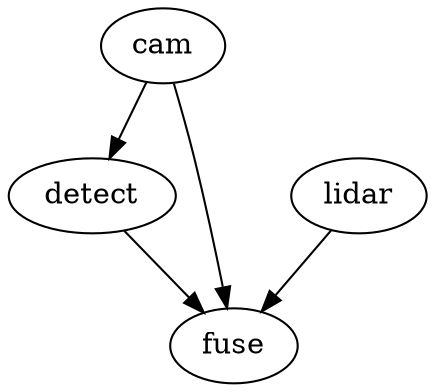

# DAG-Scheduler

Tooling for real-time task DAGs, built on a small MLIR dialect (`rt`) defined in
[IRDL](https://mlir.llvm.org/docs/Dialects/IRDL/) and driven from Rust via melior.

All builds/tests run inside the devcontainer (LLVM/MLIR 23).

## Model

A program is a DAG of **nodes**:

| kind     | attributes        | notes                                  |
|----------|-------------------|----------------------------------------|
| `sensor` | `wcet`, `period`  | periodic source, no dependencies       |
| `task`   | `wcet`            | depends on zero or more other nodes    |

The graph is acyclic, may have several sources, and has **exactly one sink**.
Times are `i64` ticks (convention: microseconds).

## The `rt` dialect

Defined in [`crates/rt-dialect/irdl/rt.irdl.mlir`](crates/rt-dialect/irdl/rt.irdl.mlir):

- `!rt.token`: a dependency edge. Every node produces one.
- `rt.sensor` (no operands): `{name, wcet, period}` → `!rt.token`
- `rt.task` (variadic `!rt.token` operands): `{name, wcet}` → `!rt.token`

A DAG is a `func.func` tagged `rt.graph` that returns the sink's token:

```mlir
func.func @pipeline() -> !rt.token attributes {rt.graph} {
  %0 = "rt.sensor"() {name = "cam", period = 10 : i64, wcet = 2 : i64} : () -> !rt.token
  %1 = "rt.task"(%0) {name = "detect", wcet = 5 : i64} : (!rt.token) -> !rt.token
  return %1 : !rt.token
}
```

Design notes:
- Edges are SSA use-def chains, so passes can walk the graph with standard MLIR APIs.
- The `func` body is an SSACFG region, so dominance forces topological order and the
  verifier rejects cycles. (`builtin.module` is a *graph* region and wouldn't, and IRDL
  can't give a custom container op the `NoTerminator` trait.)
- IRDL dialects have no custom assembly format, so IR prints in generic form.
- IRDL checks op structure and attribute kinds. `rt_dialect::verify_rt` adds the checks
  IRDL can't express: `i64` times, values > 0, and unique node names.

## DOT input



- `wcet` is required on every node, `period` is required on sensors and not allowed on tasks.
- `node [...]` defaults apply to nodes mentioned afterwards.
- Other attributes (`label`, `shape`, ...) are ignored, so DOT files written for
  visualisation still import.

See [`examples/`](examples/).

## Usage

```sh
cargo run -p rt-cli -- import examples/pipeline.dot            # print rt MLIR
cargo run -p rt-cli -- import examples/pipeline.dot -o out.mlir
cargo run -p rt-cli -- irdl > rt.irdl.mlir                     # dialect definition
mlir-opt --irdl-file=rt.irdl.mlir out.mlir                     # use with upstream tools
cargo test --workspace
```

## Crates

- `rt-schema`: format-agnostic `Dag` model, validation, and the DOT frontend
- `rt-dialect`: IRDL loading, op builders, `Dag` → MLIR, `verify_rt`
- `rt-cli`: command-line driver
- `rt-passes`, `rt-emit`: placeholders for analyses and back-ends
